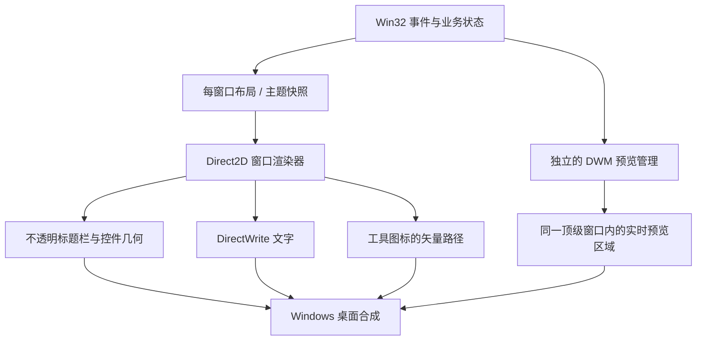

# WindowCue 跨系统显示问题研究与整改方案

研究日期：2026-10-23。源码基线：`d0e9053facbcf0c35fc3e6cca4e5399bf44eb1a2`，版本 `1.0.4.0`。

本文保留研究时的截图分析、源码对照、对比度计算与设计方案。随后已按用户指令开始实施，当前实现及实际验收边界见 [1.1.0.0 改造记录](RenderingImplementation-1.1.0.0.md)；下文中“尚未实施”的描述属于原研究阶段，不能替代最新实现记录。

## 1. 结论

需要整改的是**渲染层的职责划分和跨系统兼容设计**。建议保留 C++/Win32、快捷键、窗口枚举、托盘、自启动和 MSIX/便携发行方式，将应用界面统一迁移到 **Direct2D 直接绘制几何 + DirectWrite 绘制文字**。

标题栏、按钮、圆角、边框、开关及工具图标由同一套绘制规则处理；取消 UI 图标的 SVG → HBITMAP → AlphaBlend 流程，以及标题栏的透明黑底和多次位图覆盖。Windows 自身仍负责桌面合成与窗口管理。

这不是说 `BitBlt` 双缓冲本身有问题，也不能仅凭白边断言 alpha 算法错误。源码已经证实的问题包括无矢量抗锯齿的圆角/边框绘制、低对比度按钮文字、未处理的 Windows 版本能力差异；DWM 与 GDI/位图混合则扩大了兼容和状态同步风险。

用户截图中的路径显示 `s1ksec.WindowCue_1.0.1.0_x64_...`，且没有新版设置齿轮，指向旧版测试包。当前 `1.0.4.0` 仍保留上述核心绘制机制和暗色按钮配色问题，因此不能把整改简化为升级现有包。

## 2. 截图现象与源码依据

| 现象 / 检查 | 研究结果 | 依据及确定性 |
| --- | --- | --- |
| 亮色界面仍有黑色标题栏，标题和窗口控制不清晰 | 两张原始 PNG 的标题栏中部采样均为 `#000000`。源码清黑顶部 34 DIP，再依赖 DWM 颜色设置；相关属性在旧系统不能作为可靠基础 | `Main.cpp:1377`、`ApplyDwmFrame()`，当前版本与 `1.0.1.0` 均存在。具体复现系统版本尚未提供，截图与该缺陷相符，尚不能声称已完成目标系统上的因果复现 |
| 卡片边框、圆角有台阶和发白的高对比边缘 | `FillRounded()` / `StrokeRounded()` 使用 GDI `RoundRect` 和整数画笔，没有 Direct2D 的几何抗锯齿路径；选中时加粗会进一步显出台阶 | `Main.cpp:454`、`:466`、`:1405`。绘制方式已确认；每处“白边”是否同时受系统边框、源预览或截图缩放影响仍需复现区分 |
| 暗色“取消绑定”文字近乎黑色 | 当前主题 `buttonText=#171717`，取消按钮 `unbindButton=#7F3232`，按 sRGB 相对亮度计算对比度约 **2.05:1**。绑定按钮和取消按钮共用前景色是明确缺陷 | `ThemePalette`、`P()`，`Main.cpp:248`、`:1488`。本次根据实际字段映射计算，已确认 |
| 不同区域像拼接的灰块 | 暗色现有 window/panel/card 分别为 `#282A30/#212121/#171717`，预览底为黑色；这些是显式指定的层级色。截图大面板内部采样一致，不能说整块填充发生了随机色差 | `P()`、`DrawInterface()`。需要统一语义层级，并把预览内容色、系统外框和 UI 背景分开判断 |
| 工具图标像贴上去的 | SVG 经 D2D 离屏绘制、CPU 回读、生成 HBITMAP，再由 GDI AlphaBlend 合成。源码确实是先栅格化再合成，尽管资源起点是矢量 | `SvgIconRenderer.cpp:66–161`、`Main.cpp:548`。当前实现已确认；不能据此推导所有边缘都存在 alpha 错误 |
| 应用自身的大图标粗糙 | 同一个默认尺寸 HICON 用在标题栏、小卡片和 58 DIP 的自身预览；资源实际已有 16/24/32/48/64/128/256 多尺寸 | `Main.cpp:2492`、`:1430`。按用途与 DPI 选择合适源尺寸缺失，放大风险已确认；具体系统实际选中的 HICON 像素尺寸需运行时记录 |

### 跨系统接口缺陷

`ApplyDwmFrame()` 和 `ApplySettingsTheme()` 调用 `DWMWA_BORDER_COLOR`、`DWMWA_CAPTION_COLOR`、`DWMWA_TEXT_COLOR`，没有检查 `HRESULT`。Microsoft 明确将这三项的支持起点列为 **Windows 11 Build 22000**；项目却承诺最低 Windows 10 1809。

当前结构先把顶部清成黑色，再假定 DWM 能按应用调色板补上标题栏颜色。在相关能力不可用的系统，这个假定无法成立。主界面和设置窗口都需要处理，不能只修标题文字或替换一个图标。[Microsoft：DWM 窗口属性](https://learn.microsoft.com/en-us/windows/win32/api/dwmapi/ne-dwmapi-dwmwindowattribute)

## 3. 目标绘制结构

“不用贴图”的实施定义：**应用自身的控件外观和工具图标直接提交几何/文字绘制命令，不将整块 UI 或图标先画成图片再覆盖。** 正常的窗口像素缓冲仍然存在。第三方应用图标、品牌原始图像和实时窗口预览属于内容，可以保留其原生像素格式；实时预览继续使用 DWM 的窗口关系，不改成截图轮播。

### 3.1 窗口渲染器

- 主窗口和设置窗口各持有自己的 `ID2D1HwndRenderTarget`，使用不透明窗口目标及明确的背景色。采用每窗口渲染状态和 DPI，不共享一个可变的全局绘制目标。
- 圆角、边框、按钮、开关和滚动条直接用 D2D 几何绘制；几何启用抗锯齿，文字走 DirectWrite。缓存画刷、路径、文字布局，避免每次绘制创建整窗 DIB、DC、画笔并拷贝。
- 处理 `EndDraw()` 的失败、`D2DERR_RECREATE_TARGET`、窗口尺寸变化及资源重建。硬件不可用时使用同一套 D2D 几何命令的软件目标，验证远程桌面和虚拟机表现。
- 不采用“先用 D2D 画离屏 UI 图片，再 BitBlt 回原 GDI 界面”作为最终架构。

Direct2D 提供直接面向 HWND 的绘制目标及设备资源生命周期；DirectWrite 与 D2D 直接配合绘制文字。[窗口目标与资源重建](https://learn.microsoft.com/en-us/windows/win32/direct2d/render-targets-overview)、[文字绘制](https://learn.microsoft.com/en-us/windows/win32/direct2d/direct2d-and-directwrite)

### 3.2 标题栏和系统窗口行为

选定**完整、不透明、直接矢量绘制的应用标题栏**，使 Windows 10 和 Windows 11 的应用主题由同一套背景与前景决定。

- 撤除当前顶部 `DwmExtendFrameIntoClientArea` 扩展玻璃依赖、清黑操作、`DrawCompositedTitle()` 和位图覆盖路径；迁移时显式撤销已有扩展区域，避免旧状态遗留。
- 标题、设置、主题切换、最小化、最大化/还原和关闭使用同一渲染器；设置仍在主题按钮左侧。
- 保留 Win32 窗口管理语义。系统外框/阴影和应用标题栏的绘制职责必须唯一，不能出现系统按钮和自绘按钮重叠。
- 补齐拖动、双击最大化/还原、系统菜单、Alt+Space、Alt+F4、Win+方向键、触摸命中，以及最大化工作区和任务栏边界。缩放边框若保留，按 DPI 获取系统尺寸，不在任意边缘硬编码像素。
- 在 Windows 11 检查 `HTMAXBUTTON` 等命中及 Snap Layout；不能只绘制一个看似最大化的图形。[Microsoft：自定义标题栏与 Snap Layout](https://learn.microsoft.com/en-us/windows/apps/desktop/modernize/ui/apply-snap-layout-menu)
- 系统外框颜色、圆角等可选增强必须检查能力和 `HRESULT`；失败后界面仍可正确显示。应用主题正确性不依赖这些增强。
- 若自绘标题栏的系统交互或无障碍无法达到验收要求，兼容回退为完整原生标题栏，设置/主题入口放入客户区工具栏。回退同样不用图片拼接，不继续使用现有半透明混合方案。

### 3.3 主题与状态颜色

- 新建 `ThemeTokens`，使用明确的具名赋值和用途，替代当前几十个 `RGB` 按位置排列的初始化。
- 拆分普通按钮、危险操作、禁用、悬停、按压、焦点和选中状态的背景/前景/描边；禁止绑定与取消绑定共用一个不适合两种底色的 `buttonText`。
- 亮色窗口底继续为 `#F5F8FC`；面板和卡片只保留有用途的层级差异。同一种表面角色在标题栏、主窗口、设置中使用相同规则。
- 主题切换一次性生成快照，更新主窗口、设置、图标、工具提示和必要的系统边框，然后统一请求绘制；避免不同部件跨帧使用不同主题。
- 覆盖 `WM_THEMECHANGED`、`WM_SYSCOLORCHANGE`、相关 `WM_SETTINGCHANGE`、高对比度和客户区动画偏好。手动选定主题与系统主题分离，高对比度模式采用系统可读配色。
- 正常小字以前景/背景 **≥4.5:1** 作为工程验收目标，尤其覆盖危险操作与焦点状态。此处借用 W3C 可读性目标，不等于宣称桌面应用已通过 WCAG 认证。[W3C：对比度](https://www.w3.org/WAI/WCAG22/Understanding/contrast-minimum.html)

### 3.4 几何、DPI、文字和图标

- 布局内部统一为浮点 DIP，窗口/鼠标/DWM 接口边界再转换物理像素；主窗口和设置窗口各自接收真实 `WM_DPICHANGED`。
- 对细直线按当前 DPI 和笔宽做像素对齐，不把所有曲线和文字强行吸附到整数，也不对所有描边一律加半个 DIP。
- 统一圆角参数含义。现有 GDI `RoundRect` 最后两个参数是椭圆宽高，当前帮助函数却命名为 `radius`；D2D 使用实际半径，迁移时必须转换并重新核对，不能机械照搬数值。
- 文字使用 DirectWrite 测量与绘制，保留中英文省略、基线、路径显示和每窗口字体尺寸。不透明目标使用合适的文字抗锯齿策略；透明内容按 alpha 规则选择灰度，不能把透明面 ClearType 文字当普通图像合成。[Microsoft：像素格式、alpha 与 ClearType](https://learn.microsoft.com/en-us/windows/win32/direct2d/supported-pixel-formats-and-alpha-modes)
- 齿轮、太阳、月亮和 GitHub 使用统一坐标系下的 `ID2D1PathGeometry` / 圆弧 / 线段，保留原设计轮廓；按主题传入画刷，按目标尺寸直接绘制，缓存几何而非 HBITMAP。[Microsoft：路径几何](https://learn.microsoft.com/en-us/windows/win32/api/d2d1/nf-d2d1-id2d1factory-createpathgeometry)
- 自身大图标按目标像素尺寸读取现有高分辨率资源，避免将系统默认尺寸图标放大。第三方图标按可取得的最佳尺寸读取，保持其原始内容及透明度，不人为重绘第三方品牌。
- 保持已确定的紧凑设置：正常客户区约 `300×106 DIP`，开关 `36×20 DIP`，GitHub 为 `20 DIP` 图标、`32×32 DIP` 点击区域，无普通开启/关闭文字和驻留说明。
- 自绘控件提供焦点、Tab/Enter/Space/Escape 和 UI Automation 语义。开关暴露实际切换状态，GitHub 暴露链接名称；无障碍名称不需要变成可见文字。

### 3.5 实时预览：迁移前先验证的关键边界

当前预览已经由独立的 DWM 机制合成，`InvalidateCardDecoration()` 通过 GDI 更新区域减去预览矩形，避免装饰重绘覆盖预览。迁移后，**不能假定 `BeginPaint()` 的 GDI 非矩形裁剪会自动约束 D2D 渲染和呈现**。

先制作只有两张卡片和一个动态测试源窗口的独立原型，完成以下验证后再迁移整个界面：

1. 主 HWND 保留普通桌面重定向合成；预览仍注册在同一顶级窗口。`DwmRegisterThumbnail()` 要求目标为顶级窗口，因此不采用“每个预览塞进子 HWND”作为未经验证的修补。[Microsoft：DwmRegisterThumbnail](https://learn.microsoft.com/en-us/windows/win32/api/dwmapi/nf-dwmapi-dwmregisterthumbnail)
2. 明确装饰区和预览区。D2D 中显式管理裁剪与脏区；研究使用 `D2D1_PRESENT_OPTIONS_RETAIN_CONTENTS` 保留内容做局部更新。它只约定保留帧内容，不保证与 DWM 缩略图自动无冲突，必须实测。[Microsoft：呈现选项](https://learn.microsoft.com/en-us/windows/win32/api/d2d1/ne-d2d1-d2d1_present_options)
3. 验证整窗重绘、悬停、失焦、主题切换、滚动、设备重建和源窗口恢复时，无黑块、白块、残留或缩略图闪烁。保留源矩形/目标矩形、可见性和激活状态的提交缓存。
4. DWM 缩略图不会自动继承 D2D 的任意圆角裁剪。第一版将预览矩形放在卡片圆角内部，明确内边距，避免为了裁切引入另一套窗口捕获/贴图管线。
5. 源窗口自身的白边、黑底和长宽比留白属于预览内容，不能与 UI 的白边混为一谈。保留真实内容，预览占位背景使用主题角色。

该原型是选定渲染方案的通过条件。如果目标系统上 D2D 呈现仍干扰实时预览，先调整窗口绘制与预览呈现边界，再推进迁移；不得用定时截图替换预览来绕过问题，也不得宣称该并存方式已被验证。

## 4. 实施顺序与代码范围

| 阶段 | 工作 | 可审查交付 / 通过条件 |
| --- | --- | --- |
| 0：复现基线 | 在问题系统记录 Windows 构建、包版本、DPI、主题、显卡/远程会话条件；对旧包及当前包复现。记录 DWM 属性调用结果和源/目标预览矩形 | 原始 PNG、环境记录、可重复操作步骤；明确哪些边缘来自 UI、系统外框或预览内容 |
| 1：渲染原型 | D2D 不透明目标、DWrite 文字、完整标题栏和 DWM 动态预览并存；验证硬件与软件目标 | Windows 10/11 的真实主题与 DPI 测试通过；预览和窗口操作无退化。未通过前不替换产品默认渲染 |
| 2：主题与主界面 | 引入具名主题角色和控件状态；卡片、按钮、输入区、滚动条和工具图标迁移到直接几何绘制 | 主界面不再使用 GDI RoundRect/DrawText 或 UI 图标 HBITMAP 合成；解决取消绑定低对比度 |
| 3：设置与窗口交互 | 设置使用同一渲染器；移除旧玻璃标题栏/位图辅助路径；补齐焦点、UIA 和系统窗口命中 | 紧凑设置、纯 GitHub 图标、启动状态提示保持既有产品行为，主/设置窗口主题一致 |
| 4：跨系统验收与发行 | 执行下表矩阵、既有业务回归、便携启动及已安装 MSIX 验证；核对系统 DLL 依赖 | 原始截图与日志可追溯到最终二进制；验收后分别输出 CN/EN 便携包与正式身份 CN MSIX |

建议代码组织：

| 文件 / 模块 | 职责 |
| --- | --- |
| `RenderContext.h/.cpp`（新增） | 每 HWND 的 D2D/DWrite 资源、DPI、绘制目标、设备恢复与脏区 |
| `Theme.h/.cpp`（新增） | 具名颜色、控件状态、系统高对比度与主题快照 |
| `IconGeometry.h/.cpp`（替代 UI 用 SvgIconRenderer） | 工具图标几何与按主题直接绘制 |
| `WindowChrome.h/.cpp`（新增） | 标题栏绘制边界、系统命中、最大化工作区、菜单与交互 |
| `ThumbnailPresenter.h/.cpp`（从 Main 提取） | DWM 注册、源/目标矩形、缓存、裁剪边界与错误处理 |
| `Main.cpp` | 保留窗口消息与业务编排；删除旧 GDI 主绘制、玻璃标题与位图叠加辅助实现 |
| `tests/`、各构建脚本 | 几何/主题/设备恢复和真实视觉检查；补充源文件及 `dwrite.lib` 等系统库，更新系统 DLL 允许列表 |

快捷键目标识别、用户绑定文件、自启动实现、配置目录与正式包身份不属于本次渲染重构范围。继续使用 C++ `/MT` 与 Windows 自带绘图库，不因渲染迁移引入额外 UI 运行时。MSIX 与便携版仍使用同一界面源码；MSIX 要验证安装后的实际运行，不能只凭 MakeAppx 通过认定显示正确。

## 5. 验收标准

| 维度 | 必测条件 | 通过标准 |
| --- | --- | --- |
| 操作系统 | 问题机；Windows 10 和 Windows 11 各至少一套，记录真实构建号。若继续声明最低 1809，必须补 `17763` 的实际/虚拟机验证 | 标题栏背景和前景由正确主题控制，不依赖不受支持的 DWM 颜色属性；设备不支持可选增强也可用 |
| DPI | 100%、125%、150%、175%、200% 的真实系统缩放；混合 DPI 屏幕之间往返移动，主窗口与设置分别验证 | 圆角连续、边框规则一致，文字和图标不被二次缩放，无裁切；仅修改 `g.dpi` 的模拟不能代替这些结果 |
| 主题与状态 | 两主题、应用与系统主题不同、活动/失焦、悬停/按压/焦点/禁用/选中；连续切换至少 20 次 | 同一表面角色无意外色块或旧主题残留；不存在与本主题前景/背景无关的白色轮廓。正常抗锯齿过渡不误判为白边 |
| 可读性 | 主标题、路径、按钮、错误提示；绑定和取消绑定分别检查 | 正常小字主题色对比度 ≥4.5:1；不能只验证 GitHub 点击区外围颜色 |
| 窗口管理 | 拖动、最大化/还原、最小化、Alt+Space/Alt+F4、Win+方向键、Windows 11 Snap、任务栏边界 | 系统功能和视觉点击区一致，最大化不遮挡任务栏，恢复尺寸正确 |
| 实时预览 | 动态源、最小化/恢复、Win+D、切换前台、缩放、列表增减和滚动 | 不溢出、不冻结、不因主题/装饰重绘闪烁，保持原 DWM 预览语义 |
| 渲染恢复 | 虚拟机/远程桌面、软件目标、显示模式切换、设备资源重建 | 使用同一矢量路径恢复，无图片回退；隐藏或最小化时停止不必要动画，空闲无持续重绘 |
| 交互与无障碍 | Tab/Enter/Space/Escape、Ctrl+,、屏幕阅读器、系统高对比度 | 焦点与开关状态可读、GitHub 链接可操作，图标之外无多余可见标签 |
| 发行方式 | CN/EN 便携版；已安装的正式身份 CN MSIX；正常启动/托盘唤出/自启动唤起 | 两渠道使用同一渲染行为；默认静默托盘、关闭启动后的持久化和用户绑定均无回归 |

视觉记录保存原始比例 PNG、运行环境、二进制版本和渲染后端。平坦区域检查同角色的一致性，边缘与文字检查实际对齐、混色和对比度；预览内容与系统控制的外部阴影单独判断。不以一台机器上的截图、模拟 DPI 或单纯进程退出码替代跨系统验收。

## 6. 本次研究的边界

本次已确认渲染层需要统一，也定位了现有源码中的具体兼容与配色缺陷。另一系统的确切 Windows 构建、缩放比例及渲染条件尚未收到；白边的逐像素因果复现、D2D 与现有 DWM 预览并存原型、设备恢复和真实跨屏验证均列为实施工作，尚未完成。

之前 `1.0.4.0` 的实际视觉记录覆盖 120 DPI 桌面；96/144/192 DPI 为主窗口布局模拟。已有测试能保护若干布局和业务路径，但没有覆盖本方案要求的真实 Windows 版本矩阵、取消绑定对比度及全部边缘质量。这是本次需要补齐的验收缺口。
